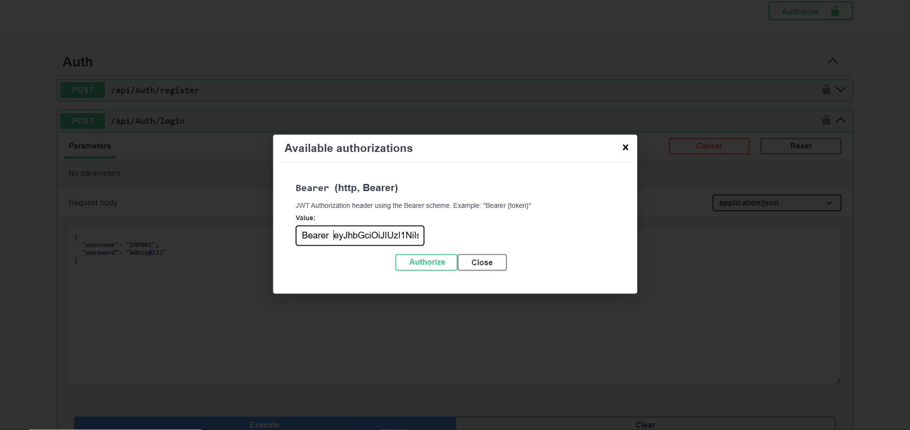
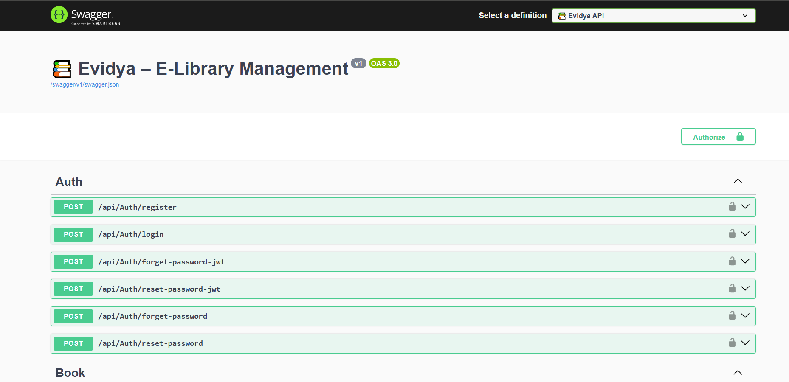
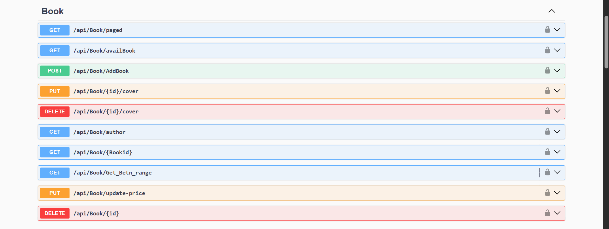
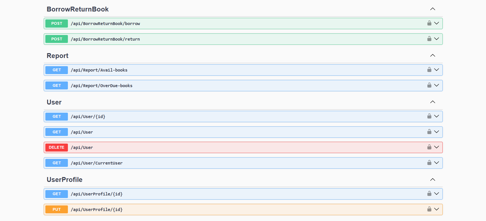

# 📚 Evidya – E-Library Management System

A **.NET Web API** for managing books and users in a digital library.
Users can **borrow and return books**, while admins can **manage books and view reports**.

The system automatically updates **book availability** and sends **email notifications** for borrow and return actions.

---

The browser entry point is the API Gateway at `http://localhost:8000`. Identity Swagger is on port 8001 and Book Swagger is on port 8002.

---

## 🚀 Features

* User registration and login with **JWT Authentication**
* **Role-Based Access Control (Admin / User)**
* Borrow and return book functionality
* Automatic book availability count update
* Email notifications for borrow and return actions
* Admin reports for **available and overdue books**
* Integrated **Swagger API documentation**

---

## 🛠 Tech Stack

* ASP.NET Core Web API
* C#
* Entity Framework Core
* PostgreSQL
* MongoDB for book covers and profile images
* JWT Authentication
* API Gateway (Ocelot)
* Identity, Book, borrow/return, and reports services
* CQRS Pattern

---
## ☁ Deployment

Run the services locally with `start-eLibrary-all.ps1`. PostgreSQL database `eLibrary` and MongoDB database `elibrary_media` must already be available.

The frontend Dockerfile is in `FroentendLovable/Dockerfile`. Service Dockerfiles and a Docker Compose file are not part of this solution yet. `ocelot.docker.json` is ready for container host names `identity` and `book` when that stack is added.
---

## 📷 API Documentation (Swagger)

### 🔐 Authentication APIs



### 📊 Swagger API Overview



### 📚 Book Management APIs



### 👤 User, Borrow & Report APIs



---

## ▶ Run the Project

Clone the repository:

```bash
git clone https://github.com/PratikByte/eLibrary.git
cd eLibrary
```

Start PostgreSQL on port 5432 and MongoDB on port 27017, then launch the services and frontend:

```powershell
.\start-eLibrary-all.ps1
```

The script starts:

| App | URL |
|-----|-----|
| Gateway | http://localhost:8000 |
| Identity | http://localhost:8001/swagger |
| Book, borrow/return, and reports | http://localhost:8002/swagger |
| Frontend | http://localhost:3001 |

The frontend calls the Gateway. `FroentendLovable/.env.example` sets `VITE_API_BASE_URL=http://localhost:8000`.

Apply the Identity and Book migrations from their API projects when the databases are empty. Each service keeps its own EF Core history table in the shared `eLibrary` PostgreSQL database.

---

## 📂 Project Architecture

```
Services/Gateway     public API entry
Services/Identity    users, login, profiles
Services/Book        catalog, borrow/return, reports
Services/Shared      shared API error handling
FroentendLovable     React frontend
```

Borrow/return and reports stay inside the Book service because a borrow updates book availability in the same database transaction.

---

## 👨‍💻 Author

**Pratik Zodpe**

---

⭐ If you like the project, consider giving it a **star**.
